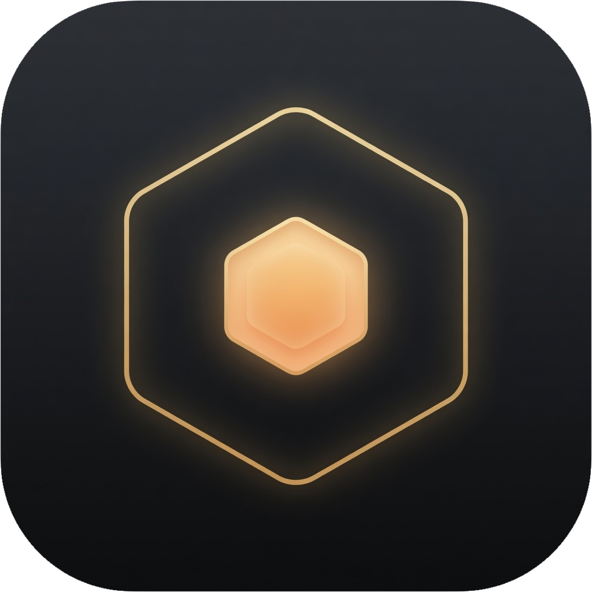

<p align="center">
  
</p>

<h1 align="center">Hive</h1>

<p align="center">Signal over noise — a fast, local-first RSS reader.</p>

<p align="center">
  
  
  
  
  
</p>

<p align="center"><strong>English</strong> · <a href="README.zh-CN.md">简体中文</a></p>

---

Hive is a desktop RSS reader that keeps everything on your machine. Many feeds
flow into one hive — articles, podcasts, YouTube, newsletters, and social
timelines — stored in a single local SQLite database. No account, no cloud,
no tracking. And when you want to script it, a JSON-speaking CLI shares the
same library.

## Features

**Subscribe to anything**
- RSS, Atom, and JSON Feed, with automatic feed discovery from a page URL
- Source-aware handling for YouTube, Reddit, Mastodon, Bluesky, podcasts, and newsletters
- Subscribe by email: poll an IMAP mailbox and turn newsletters into a feed
- A built-in Source Hub: browse a multi-source feed directory, preview before
  subscribing, and bulk-subscribe a whole view in one click
- `rsshub://` short links, `hive://subscribe` deep links, OPML import / export
- Per-feed refresh intervals, plus per-feed or per-folder manual refresh

**Read well**
- A clean, full-screen reading overlay with adjustable font, size, leading, and
  width — including downloadable open-source fonts and careful mixed CJK/Latin
  typography
- Choose how articles open — feed text, auto-extracted full text
  (readability), or the original page in a native web view — globally and
  per feed
- Full-screen image viewer: click any image, flip through the article's
  gallery with ← / →
- List or card view, hover previews, estimated reading time, Space paging,
  and a focus mode for distraction-free reading
- Built-in audio player for podcast / audio enclosures

**Organize & find**
- Folders, tags, and smart views (All, Unread, Starred, Read Later)
- Full-text search powered by SQLite FTS5 (Unicode-aware)
- Filter rules that skip, mark, or star incoming articles automatically
- Highlights & reading notes: multi-color annotations saved locally, with a
  review panel to revisit them

**Translate & augment (bring your own keys)**
- Multi-engine translation — LLM, Google, DeepL, Bing — streaming, structure-
  preserving, with original / translated / bilingual views
- Auto-translate per feed, and translate list previews (title + snippet) as
  rows scroll into view, cached so scrolling back is free
- AI summarize / ask / digest with streaming responses (Anthropic, OpenAI,
  DeepSeek, or any OpenAI-compatible endpoint — including local servers)

**Sync & integrate**
- Two-way sync with FreshRSS / Miniflux via the Google Reader API —
  subscriptions converge both ways, and read/starred state reconciles across
  the whole library, not just recent items
- macOS menu-bar tray with a live unread count, notifications, autostart,
  single-instance handling

**Make it yours**
- Light / dark / follow-system appearance, three dark depths, gold plus the
  cool accent palettes (azure · cyan · emerald · indigo · violet · slate) or
  any custom color, all derived in OKLCH
- Command palette (`⌘K`), a thorough keyboard map, reduced-motion support
- Localized in English, 日本語, and 简体中文

## hive-cli

Everything in the library is scriptable. `hive-cli` opens the same SQLite
database as the app (safe to use while it's running) and prints one JSON
document per command — built for LLM agents and shell pipelines.

```bash
task build:cli                 # → bin/hive-cli

hive-cli home                  # counts + latest unread
hive-cli list -unread -limit 10
hive-cli search "borrow checker"
hive-cli read 42 -mark         # full text body, mark read
hive-cli subscribe https://example.com/feed.xml
hive-cli refresh
```

See [`cmd/hive-cli/README.md`](cmd/hive-cli/README.md) for the full reference.

## Tech stack

**Backend — Go**
- [Wails 3](https://v3.wails.io/) (alpha) — native window + Go↔TS bindings
- [`modernc.org/sqlite`](https://pkg.go.dev/modernc.org/sqlite) — pure-Go SQLite with FTS5 (no CGO)
- [`mmcdole/gofeed`](https://github.com/mmcdole/gofeed) — RSS / Atom / JSON parsing
- [`PuerkitoBio/goquery`](https://github.com/PuerkitoBio/goquery) + [`microcosm-cc/bluemonday`](https://github.com/microcosm-cc/bluemonday) — HTML sanitization
- [`go-shiori/go-readability`](https://github.com/go-shiori/go-readability) — full-text extraction
- [`emersion/go-imap`](https://github.com/emersion/go-imap) + [`go-message`](https://github.com/emersion/go-message) — newsletter ingestion
- `golang.org/x/{text,sync,net}` — charset detection, semaphores, HTML tokenizing

**Frontend — Vue 3**
- `<script setup>` + TypeScript, [Pinia](https://pinia.vuejs.org/), [TanStack Query](https://tanstack.com/query) & Virtual
- [vue-i18n](https://vue-i18n.intlify.dev/), [marked](https://marked.js.org/), `@wailsio/runtime`, Vite

## Architecture

- **Services → bindings.** Each domain (`FeedService`, `ArticleService`,
  `AIService`, …) is a Go struct in `services/`, auto-exported to typed
  TypeScript by `wails3 generate bindings`. The frontend calls them like local
  async functions.
- **Streaming over events.** Long-running work (AI tokens, refresh progress,
  translation batches) emits per-request Wails events; the frontend subscribes
  with `Events.On/Off`. Streams are sequence-stamped so out-of-order delivery
  can't scramble them, and errors carry a stable `{ code, detail }` shape.
- **Local data layer.** WAL-mode SQLite with a read-only connection pool, a
  `user_version` migration runner, FTS5 search, and a custom `unicode_lower`
  function for Unicode-correct rule matching.

```
hive/
├── main.go            # Wails wiring: services, window, tray, deep links, single-instance
├── cmd/hive-cli/      # Agent-facing CLI over the same library (JSON out)
├── internal/          # Backend packages
│   ├── db/            #   SQLite data layer (migrations, queries, FTS5)
│   ├── models/        #   shared structs (camelCase JSON ↔ TS contract)
│   ├── ingestion/     #   fetch + parse feeds, refresh scheduler
│   ├── sources/       #   source URL normalization (YouTube/Reddit/Mastodon/…)
│   ├── discovery/     #   feed-directory search + deep-link parsing
│   ├── sanitize/      #   HTML sanitization & text extraction
│   ├── extraction/    #   readability full-text + lead image
│   ├── ai/            #   SSE streaming (Anthropic / OpenAI / DeepSeek)
│   ├── translate/     #   multi-engine translation
│   ├── syncer/        #   FreshRSS / Miniflux (Google Reader API)
│   ├── newsletter/    #   IMAP newsletter ingestion
│   ├── opml/          #   OPML import / export
│   ├── fonts/         #   downloadable reader/UI font pipeline
│   ├── appstate/      #   shared state (db + http client + locks)
│   ├── events/        #   panic-safe, sequenced event emission
│   └── apperr/        #   stable error codes
├── services/          # Wails services (auto-bound to TypeScript)
├── frontend/          # Vue 3 app (components, stores, composables, lib, locales)
└── build/             # Wails config, icons, per-platform Taskfiles
```

## Getting started

### Prerequisites

- **Go ≥ 1.25**
- **Node.js + npm**
- **[Task](https://taskfile.dev/)** (the `task` runner)
- **Wails 3 CLI**: `go install github.com/wailsapp/wails/v3/cmd/wails3@latest`
  (run `wails3 doctor` to verify your toolchain)

### Develop

```bash
task dev        # run with hot-reload (frontend + Go)
```

### Build

```bash
task build      # compile the app binary        → bin/hive
task package    # package the macOS app bundle  → bin/hive.app  (icon + ad-hoc signature)
task build:cli  # build the agent-facing CLI    → bin/hive-cli
```

> The Vue frontend is embedded into the Go binary (`go:embed`), so the packaged
> app is fully self-contained. Releases are built for macOS and Linux; a
> headless server mode (`task build:server`) and a Docker image are available
> for running Hive without a GUI.

### Data

Your library lives in a single SQLite file:

```
~/Library/Application Support/Hive/hive.db   # macOS
~/.config/Hive/hive.db                       # Linux
```

AI, translation, sync, and newsletter features are opt-in — add the relevant
API keys / credentials in **Settings** to enable them.

## Keyboard shortcuts

| Key | Action |
| --- | --- |
| `⌘K` / `/` | Command palette |
| `J` / `K` | Next / previous article |
| `←` / `→` | Previous / next article (in the reader) |
| `Space` | Page through the article |
| `S` / `B` / `U` | Star · read later · toggle unread |
| `C` | Copy the article link |
| `T` | Toggle translation |
| `I` | AI assistant for the current article |
| `F` | Focus reading mode |
| `O` | Open original in browser |
| `⇧A` | Mark all as read |
| `⌘R` | Refresh all feeds |

The full map lives in **Settings → Shortcuts**.

## Acknowledgements

- Hive builds on the design and data model of [papr](https://github.com/l0ng-ai/papr)
  by [l0ng-ai](https://github.com/l0ng-ai) — thanks for the original work.
- Type: **Inter Tight** by Rasmus Andersson · **Newsreader** by Production Type · **JetBrains Mono** by JetBrains
- And to everyone who maintains open standards — RSS keeps independent writing reachable.

## License

[MIT](LICENSE) — © 2026 [l0ng-ai](https://github.com/l0ng-ai) (papr, original) & sunmking (Hive)
